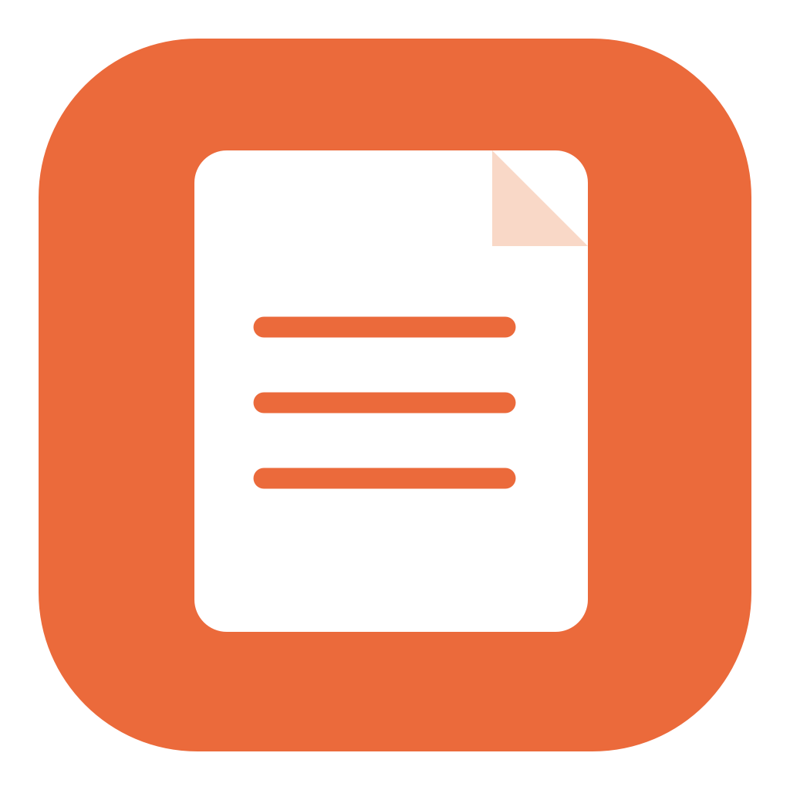
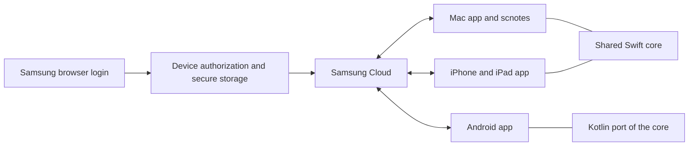

<p align="center"></p>
<h1 align="center">Samsung Cloud Notes</h1>
<p align="center">Your Samsung notes on Mac, iPhone, iPad, any Android phone and the terminal.<br>Browse, read and edit directly through Samsung Cloud.</p>
<p align="center">


<a href="LICENSE"></a>
</p>
<p align="center"><a href="#get-started">Get started</a> · <a href="docs/cli.md">Command line</a> · <a href="docs/mobile.md">iPhone &amp; Android</a> · <a href="#build-from-source">Build</a> · <a href="docs/reverse-engineering.md">Reverse-engineering findings</a> · <a href="#credits">Credits</a></p>

> **Unofficial interoperability project.** Not affiliated with, endorsed by, or supported by Samsung. These apps use reverse-engineered private APIs that can change without notice. No Samsung application, SDK, proprietary binaries or icon artwork is distributed here. Samsung Notes and Samsung Cloud are Samsung trademarks.

> **New in 1.1:** an iPhone/iPad app, an Android app for any manufacturer and the `scnotes` command line. The Mac app keeps its 1.0 behavior. The new clients are early: see [validation](docs/validation.md) for what has and has not been exercised.

## What it does

- **Connect anywhere.** Samsung's own browser login and verification on every platform; no Galaxy device, Samsung Notes install or Windows PC required.
- **Browse your library.** Notes, folders, trash, title and typed-text search.
- **Edit typed text.** Change a supported note's title and main text, then save to Samsung Cloud.
- **Keep local copies.** Persistent note/attachment caches, drafts, earlier drafts and pre-save backups.
- **Preview drawings.** Supported handwriting strokes inline or as a generated PDF.
- **Open and export.** Supported attachments, original cloud XML and a text copy.
- **Script it.** `scnotes` lists, searches, prints, edits and exports notes from the terminal, with JSON output.

| Client | Status in 1.1 |
| --- | --- |
| macOS app | 13+, universal Apple Silicon / Intel; unchanged 1.0 feature set |
| `scnotes` CLI | Runs inside the signed Mac app; read commands live-tested |
| iPhone / iPad | iOS 16+, SwiftUI, same shared Swift core as the Mac; native sign-in and library sync live-tested in the simulator |
| Android | 8.0+ (API 26), any manufacturer, Kotlin/Compose port; native sign-in and library sync live-tested on an emulator |
| Windows | Optional connection-export helper, version 0.1.3 |

**Why a native Android app instead of Samsung's APK?** Samsung Notes only syncs with Samsung Cloud on Galaxy devices, and redistributing Samsung's APK would be both unsupported and against this project's no-Samsung-binaries rule. The Android client speaks the same protocol as the Mac app instead.

## Get started

### Mac

Download the universal Mac app from the [**latest release**](https://github.com/Clascheurduturfu/samsung-cloud-notes/releases/latest), unzip it, and drag `Samsung Cloud Notes.app` to Applications. Releases include SHA-256 checksums. You can also [build from source](#build-from-source).

The app is locally signed, not Developer ID signed or notarized. If macOS blocks the first launch, use **System Settings → Privacy & Security → Open Anyway** after checking that you downloaded this release. Do not disable Gatekeeper globally.

1. Open **Samsung Cloud Notes** and choose **Sign in with Samsung**.
2. Complete Samsung's own login and verification in the browser. The app never handles your password.
3. Browse your notes. Edits stay local until you choose **Save to cloud**.

Reusable authorization is saved in Keychain and renewed automatically. If Samsung revokes it, sign in again. Click your email at the bottom of the sidebar, then **Log out** to remove the saved connection and clear the visible library. Drafts and cache remain. This does not revoke every Samsung session or sign out the browser.

The welcome screen also offers **Import Windows connection** as a fallback, using the official Samsung Notes app on Windows and the optional [Windows helper](docs/windows-helper.md). Imported sessions retain the Windows device identity and cannot renew independently; native sign-in is preferred.

### Terminal

Choose **Samsung Cloud Notes → Install Command Line Tool…** in the Mac app (or run `"/Applications/Samsung Cloud Notes.app/Contents/MacOS/SamsungCloudNotes" --cli install`). It installs `scnotes` in `~/.local/bin`:

```sh
scnotes list --limit 10
scnotes search "shopping"
scnotes show "Shopping list" --json
scnotes edit "Shopping list" --body-file list.txt
```

`scnotes` uses the Mac app's saved sign-in and cache; sign in once in the app. See the [command line guide](docs/cli.md).

### iPhone, iPad and Android

There are no store builds. The [latest release](https://github.com/Clascheurduturfu/samsung-cloud-notes/releases/latest) has an Android APK and an unsigned iOS IPA for sideloading, or build from source with Xcode or Android Studio; see [iPhone & Android](docs/mobile.md) for installing, sign-in and limits. Each device signs in on its own and registers its own identity with Samsung.

### Local data and credentials

Mac notes, drafts, backups and opened attachments live under `~/Library/Application Support/SamsungCloudNotes/`; mobile apps keep the same layout in their private sandbox. Treat these as private: they contain note content. Expiring signed download URLs are removed from cached document XML. Unchanged revisions reuse cached documents; refresh downloads changed or missing content.

On the Mac, credentials use a small signed Keychain helper and anonymous pipes; a local signing identity and unchanged helper preserve access across ordinary rebuilds. iOS stores them in the app's Keychain, Android seals them with a non-exportable Android Keystore key. See [authentication and signing](docs/authentication.md).

Samsung's private services require an accepted Android compatibility profile on every platform. The cloud model and alias identify the real device (Mac, iPhone, iPad or the Android model), but Samsung may categorize every connection as Android. [The research note](docs/reverse-engineering.md) explains why.

## Know the limits

- Version 1.1 handles existing notes. Creating/deleting notes, a full S Pen editor and complete page composition are outside the current UI.
- Editing text replaces formatting in that text object. Other original page objects, drawings and attachment references are retained. Locked/encrypted notes and unsupported text encodings are not editable.
- Drawing previews approximate width and pressure; complex brushes, erasers, rotations and image/background composition may differ or be unsupported.
- Export creates a `.samsungnote` **folder archive for this client** (zipped on mobile), not a native Samsung `.sdocx` file.
- Saves check the current revision first, keep a backup and verify text by downloading it again. Atomic server-side compare-and-swap has not been established. Keep an independent backup of important notes.
- The Android and iOS apps are new in 1.1; see [validation](docs/validation.md). On a brand-new Android browser profile Samsung may show *Access denied* before the login form; open account.samsung.com once in that browser and retry.
- Builds are locally signed, not Developer ID signed or notarized; mobile builds are for personal sideloading.

## Build from source

### macOS app and CLI

Use Xcode or the Command Line Tools, a logged-in graphical Mac session and an unlocked login Keychain. No third-party Swift packages are needed. Development used Xcode Swift 6.4 in Swift 5 language mode.

```sh
git clone https://github.com/Clascheurduturfu/samsung-cloud-notes.git
cd samsung-cloud-notes
bash scripts/build-macos.sh
```

Output: `dist/Samsung Cloud Notes.app`, targeting macOS 13 with both architectures, CLI included. `BUILD_UNIVERSAL=0` builds Apple Silicon only. The script generates the icon, signs the app and runs offline self-tests.

The first build creates a persistent local code-signing identity in the login Keychain; temporary loose keys/password files are removed. System/TLS trust is unchanged. Retain that identity across updates: the main app and credential helper must share a certificate. `SIGNING_IDENTITY` selects an existing identity; reusing an installed helper from a differently signed copy requires a deliberate migration. See [the build guide](docs/building.md).

### iPhone / iPad

Open `iOS/SamsungCloudNotes.xcodeproj` in Xcode, choose your team under **Signing & Capabilities**, and run on a device or simulator. The project compiles the same `Sources/Shared` code as the Mac app.

### Android

Use Android Studio (or JDK 17+ with the Android SDK) and open `android/`, or:

```sh
cd android
./gradlew :app:assembleRelease
```

Output: `android/app/build/outputs/apk/release/app-release.apk`, signed with your local debug key unless you configure your own. See [iPhone & Android](docs/mobile.md).

### Offline checks

```sh
bash scripts/check-macos.sh     # both Mac architectures, offline self-tests
bash scripts/check-ios.sh       # simulator build, shared self-tests in a simulator
bash scripts/check-android.sh   # JVM unit tests, debug APK
```

### Optional Windows helper

Development/live export needs Windows x64, Python 3.14 and the official Samsung Notes app. The standalone helper bundles Python for end users.

```powershell
python -m venv .venv
.\.venv\Scripts\python.exe -m pip install -r scripts/requirements-build-windows.txt
.\.venv\Scripts\python.exe -m unittest discover -s Tests -v
.\.venv\Scripts\Activate.ps1
powershell -NoProfile -File scripts/build-windows-helper.ps1
```

Output: `dist/windows/SamsungNotesConnection.exe` (unsigned). Requirements are pinned. See [helper instructions](docs/windows-helper.md) and [third-party notices](docs/THIRD_PARTY_NOTICES.md).

CI compiles the Mac sources, builds the iOS app and runs its self-tests in a simulator, runs the Android unit tests and debug build, and runs the Windows tests. It does not sign in, access a real account, modify notes or publish packages.

## How it works



| Read more | Contents |
| --- | --- |
| [Command line](docs/cli.md) | `scnotes` commands, JSON output, editing safely |
| [iPhone & Android](docs/mobile.md) | Installing, sign-in, storage and limits on mobile |
| [Reverse-engineering findings](docs/reverse-engineering.md) | Auth layers, crypto, PKCE, registration, failed routes, Windows storage and analysis landmarks |
| [Authentication](docs/authentication.md) | Sign-in, renewal, Keychain and signing design |
| [Notes protocol](docs/protocol.md) | XML, pagination, folder names, strokes and upload observations |
| [Validation](docs/validation.md) | Tested scope and outstanding checks |
| [Build and project layout](docs/building.md) | Local signing, diagnostics and source map |
| [Contributing](CONTRIBUTING.md) · [Security](SECURITY.md) | Safe fixtures and reporting |

## Credits

- **[Charles Bel / samsung-re-health](https://github.com/charlesbel/samsung-re-health)** — MIT-licensed account bootstrap, browser encryption and SCSP exchange informed the Swift adaptation in `Sources/Shared/Authentication.swift` and its Kotlin port in `android/app/src/main/java/local/samsungcloudnotes/Auth.kt`. Its [full license](docs/third-party/samsung-re-health-LICENSE.txt) is retained and bundled in Mac, iOS and Android builds.
- **[twangodev / sdocx](https://github.com/twangodev/sdocx)** — published format research helped interpret stroke framing and point channels. No upstream sdocx code is bundled.
- **[Mhemd139 / Inkport](https://github.com/Mhemd139/Samsung_Notes)** — useful reference for Samsung Notes file-viewing workflows; no upstream code is bundled.

The direct Notes XML/read/write client was established separately through Windows-client analysis and authorized cloud experiments. The icon is original artwork. Raw Samsung binaries, account databases, private captures and reference checkouts are excluded.

## License

Original code and artwork are [MIT licensed](LICENSE). Adapted code and packaged runtimes retain their licenses; see [third-party notices](docs/THIRD_PARTY_NOTICES.md).
