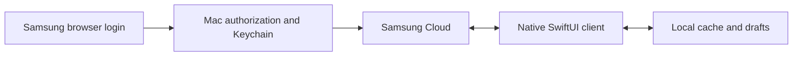

<p align="center"></p>
<h1 align="center">Samsung Cloud Notes for macOS</h1>
<p align="center">Your Samsung notes, on your Mac.<br>Browse, read and edit directly through Samsung Cloud.</p>
<p align="center">


<a href="LICENSE"></a>
</p>
<p align="center"><a href="#get-started">Get started</a> · <a href="#build-from-source">Build</a> · <a href="docs/reverse-engineering.md">Reverse-engineering findings</a> · <a href="#credits">Credits</a></p>

> **Unofficial interoperability project.** Not affiliated with, endorsed by, or supported by Samsung. This app uses reverse-engineered private APIs that can change without notice. No Samsung application, SDK, proprietary binaries or icon artwork is distributed here. Samsung Notes and Samsung Cloud are Samsung trademarks.

## What it does

- **Connect on the Mac.** Samsung's browser login and normal verification; Windows is optional.
- **Browse your library.** Notes, folders, trash, title and typed-text search in a native three-column interface.
- **Edit typed text.** Change a supported note's title and main text, then save to Samsung Cloud.
- **Keep local copies.** Persistent note/attachment caches, drafts, earlier drafts and pre-save backups.
- **Preview drawings.** Supported handwriting strokes inline or in a generated PDF.
- **Open and export.** Supported attachments, original cloud XML and a text copy.

| Support | Current scope |
| --- | --- |
| macOS | 13+, universal Apple Silicon / Intel build; live testing on Apple Silicon |
| Connection | Native sign-in, independent Mac installation identity and automatic renewal |
| Editing | Supported existing notes: title and main typed-text body |
| Handwriting | Approximate, read-only stroke preview and PDF |
| Offline | Previously cached content and local drafts; cloud required to sync/save |
| Windows | Optional connection-export helper, version 0.1.3 |

## Get started

This repository contains source for **1.0.0-rc.1**. [Build the app](#build-from-source), then place `Samsung Cloud Notes.app` in Applications. No prebuilt download is published in this repository yet.

1. Open **Samsung Cloud Notes** and choose **Sign in with Samsung**.
2. Complete Samsung's own login and verification in the browser. The app never handles your password.
3. Browse your notes. Edits stay local until you choose **Save to cloud**.

The Mac connects directly to Samsung Cloud. No Windows relay, Android emulator or Samsung Notes installation is required on the Mac. Reusable authorization is saved in Keychain and renewed automatically. If Samsung revokes it, sign in again.

Click your email at the bottom of the sidebar, then **Log out** to remove the saved connection and clear the visible library. Drafts and cache remain. This does not revoke every Samsung session or sign out the browser.

The welcome screen also offers **Import Windows connection** as a fallback, using the official Samsung Notes app on Windows and the optional [Windows helper](docs/windows-helper.md). Imported sessions retain the Windows device identity and cannot renew independently; native Mac sign-in is preferred.

### Local data and credentials

Notes, drafts, backups and opened attachments live under `~/Library/Application Support/SamsungCloudNotes/`. Treat that directory as private: it contains note content. Expiring signed download URLs are removed from cached document XML. Unchanged revisions reuse cached documents; refresh downloads changed or missing content.

Credentials use a small signed Keychain helper and anonymous pipes. A local signing identity and unchanged helper preserve access across ordinary rebuilds. macOS may request approval on first access, migration, a locked Keychain, or helper/identity replacement. See [authentication and signing](docs/authentication.md).

Samsung's private services require an accepted Android compatibility profile even on macOS. The cloud model and alias identify the Mac, but Samsung may categorize the connection as Android. [The research note](docs/reverse-engineering.md) explains why.

## Know the limits

- This release candidate handles existing notes. Creating/deleting notes, a full S Pen editor and complete page composition are outside the current UI.
- Editing text replaces formatting in that text object. Other original page objects, drawings and attachment references are retained. Locked/encrypted notes and unsupported text encodings are not editable.
- Drawing previews approximate width and pressure; complex brushes, erasers, rotations and image/background composition may differ or be unsupported.
- Export creates a `.samsungnote` **folder archive for this client**, not a native Samsung `.sdocx` file.
- Saves check the current revision first, keep a backup and verify text by downloading it again. Atomic server-side compare-and-swap has not been established. Keep an independent backup of important notes.
- Cloud readback was tested; full Samsung-device rendering remains a separate check. A borrowed Windows identity was observed skipping changes marked as its own; native Mac sign-in uses a separate identity.
- Builds are locally signed, not Developer ID signed or notarized. Intel hardware and macOS 13 have not been exercised live.

See [validation](docs/validation.md) for the exact tested scope.

## Build from source

### macOS app

Use Xcode or the Command Line Tools, a logged-in graphical Mac session and an unlocked login Keychain. No third-party Swift packages are needed. Development used Xcode Swift 6.4 in Swift 5 language mode.

```sh
git clone https://github.com/Clascheurduturfu/samsung-cloud-notes.git
cd samsung-cloud-notes
bash scripts/build-macos.sh
```

Output: `dist/Samsung Cloud Notes.app`, targeting macOS 13 with both architectures. `BUILD_UNIVERSAL=0` builds Apple Silicon only. The script generates the icon, signs the app and runs offline self-tests.

The first build creates a persistent local code-signing identity in the login Keychain; temporary loose keys/password files are removed. System/TLS trust is unchanged. Retain that identity across updates: the main app and credential helper must share a certificate. `SIGNING_IDENTITY` selects an existing identity; reusing an installed helper from a differently signed copy requires a deliberate migration. See [the build guide](docs/building.md).

For compilation and offline tests without signing setup or account access:

```sh
bash scripts/check-macos.sh
```

### Optional Windows helper

Development/live export needs Windows x64, Python 3.14 and the official Samsung Notes app. The standalone helper bundles Python for end users.

```powershell
python -m venv .venv
.\.venv\Scripts\python.exe -m pip install -r scripts/requirements-build-windows.txt
.\.venv\Scripts\python.exe -m unittest discover -s Tests -v
.\.venv\Scripts\Activate.ps1
powershell -NoProfile -File scripts/build-windows-helper.ps1
```

Output: `dist/windows/SamsungNotesConnection.exe` (unsigned). Requirements are pinned. See [helper instructions](docs/windows-helper.md) and [third-party notices](docs/THIRD_PARTY_NOTICES.md).

CI compiles the Mac sources, runs offline checks and runs the Windows tests. It does not sign in, access a real account, modify notes or publish packages.

## How it works



| Read more | Contents |
| --- | --- |
| [Reverse-engineering findings](docs/reverse-engineering.md) | Auth layers, crypto, PKCE, registration, failed routes, Windows storage and analysis landmarks |
| [Authentication](docs/authentication.md) | Sign-in, renewal, Keychain and signing design |
| [Notes protocol](docs/protocol.md) | XML, pagination, folder names, strokes and upload observations |
| [Validation](docs/validation.md) | Tested scope and outstanding checks |
| [Build and project layout](docs/building.md) | Local signing, diagnostics and source map |
| [Contributing](CONTRIBUTING.md) · [Security](SECURITY.md) | Safe fixtures and reporting |

## Credits

- **[Charles Bel / samsung-re-health](https://github.com/charlesbel/samsung-re-health)** — MIT-licensed account bootstrap, browser encryption and SCSP exchange informed the Swift adaptation in `Sources/Authentication.swift`. Its [full license](docs/third-party/samsung-re-health-LICENSE.txt) is retained and bundled in Mac builds.
- **[twangodev / sdocx](https://github.com/twangodev/sdocx)** — published format research helped interpret stroke framing and point channels. No upstream sdocx code is bundled.
- **[Mhemd139 / Inkport](https://github.com/Mhemd139/Samsung_Notes)** — useful reference for Samsung Notes file-viewing workflows; no upstream code is bundled.

The direct Notes XML/read/write client was established separately through Windows-client analysis and authorized cloud experiments. The icon is original artwork. Raw Samsung binaries, account databases, private captures and reference checkouts are excluded.

## License

Original code and artwork are [MIT licensed](LICENSE). Adapted code and packaged runtimes retain their licenses; see [third-party notices](docs/THIRD_PARTY_NOTICES.md).
