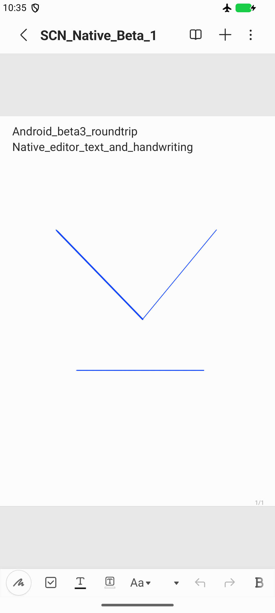

# Native Samsung Notes on generic Android

Status: **early beta `1.2.0-beta.3+5` (untested by the owner on physical hardware; emulator-validated only)**, merged into `main` in `1.1.1`. This work keeps Samsung's Android editor and native document engine. The existing Compose Android client and Apple clients remain separate applications.

## Approach and reference

[Yanndroid/Samsung-Notes-Port](https://github.com/Yanndroid/Samsung-Notes-Port) is a useful historical reference. Its [initial compatibility change](https://github.com/Yanndroid/Samsung-Notes-Port/commit/69e29b39a770) makes the `com.samsung.device` shared library optional. That removes an installation requirement; it does not supply Samsung Account, One UI APIs or cloud authorization.

The owner-provided baseline for this project is Samsung Notes **4.4.48.15**, version code **444815000**, minimum Android 10/API 29, ARM64 and ARMv7. Its SHA-256 is `484d3dd599355789508034ba90af9a35e09f81532564a992c131710632a467ce`. Input hashes are pinned: unsupported APK versions must fail before patching. No Samsung APK, native library, decompiled application tree, account connection or proprietary source is included in Git.

Using a current owner-provided version avoids committing to the much older 4.4.09.6 port as the document engine. That matters because [Samsung documents note-format compatibility limits across newer One UI versions](https://www.samsung.com/us/support/troubleshoot/TSG10013305/).

## Modules

- `android/auth-core`: the existing Kotlin Samsung browser/OAuth/cloud identity implementation, extracted for reuse. The standalone app now depends on this module. Cryptography, host validation, PKCE, encrypted callback parsing, token renewal and Android Keystore storage are shared.
- `android/native-bridge`: a small Android activity/provider and account-contract adapter. It compiles without Samsung classes, refers to listeners through their public callback signatures, and reuses the original APK's Kotlin/coroutines runtime.
- `android-samsung-port`: source-only compatibility shims, hash-pinned patches and a local build tool. The caller supplies an owned original APK and local signing key.

The account screen displays `1.2.0-beta.3+5`; the native package reports `4.4.48.15-native-beta.3`. Download-only mode is the initial setting. Enabling **Two-way sync** restores Samsung's original folder and note upload phases, serializer, revision comparison and pending-edit handling. This is an emulator-validated beta, not a claim of support for every Android device.

## Using the native beta

1. Build locally from the exact owner-supplied APK using [the builder](../android-samsung-port/README.md), then install on a generic ARM test device. A port signed with a local key cannot replace the official Samsung-signed installation. Keep the same local key for updates.
2. Open Samsung Notes, then **Settings → Samsung Cloud** and **Sign in with Samsung**. Complete verification in the browser. Windows and the Samsung Account system app are not required.
3. Use **Download notes** for a local library. Enable **Two-way sync** to send native edits and folder changes to Samsung Cloud; **Sync now** requests an immediate sync. Samsung's normal Wi-Fi-only setting still applies.
4. Edit text, handwriting and pages in Samsung's editor. Native documents remain available offline; edits are queued locally until the next successful sync.
5. Tap the email address to open **Sign out**. This disables sync and deletes the bridge's saved connection. Another account cannot be attached to this local library without exporting notes and explicitly clearing app storage first.
6. Export with **Share → Samsung Notes file → Save to Files**. Reopen with **Settings → Samsung Cloud → Import Samsung Notes file**. The standard Android pickers support providers with opaque file IDs and avoid Samsung My Files. Filename-based content providers can also offer Samsung Notes directly for `.sdocx` files.

## Observed compatibility issues

Tests use a dedicated, non-rooted, Google Play ARM64 API 37 emulator on the Mac. The real Samsung phone is a read-only source for the original APK and is not modified or used as an installation target.

| Observed failure | Compatibility change | Scope |
| --- | --- | --- |
| Required `com.samsung.device` shared library | Mark it optional | Installation |
| `SettingsSearchProvider` reads `Configuration.semDesktopModeEnabled` during startup | Disable that optional provider | Samsung Settings search integration |
| Missing `SemFloatingFeature` | Original shim reports absent Samsung features or the caller's supplied default | Capability discovery; does not claim One UI support |
| Missing `SemFingerprintManager` | Return an unavailable manager | No biometric unlock is granted |
| Composer instantiates Samsung clipboard listener on AOSP | Skip Samsung clipboard-history filtering | Ordinary Android copy/paste is a separate path and still requires functional testing |
| Missing `Build.VERSION.SEM_PLATFORM_INT` | Return platform version zero at seven audited call sites | Samsung-specific voice/AI/diagnostics feature checks |
| Missing `TextView.semSetMultiSelectionEnabled` in list thumbnails | Omit the optional Samsung text-selection flag | Native thumbnail construction |
| Untyped foreground services crash at modern target SDK | Declare `dataSync` for document persistence and collection | Local file processing; [Android service-type requirements](https://developer.android.com/develop/background-work/services/fgs/service-types) apply |
| The WEB account constructor omits a token-controller reference used on login transitions | Connect the already-created token controller in that branch | Preserve native login-state listeners; no fake system account |
| Sync availability requires Samsung branding and an installed Samsung Account package | Recognize the actual bridge account provider at that specific check | Existing power, demo-device and Knox restrictions are retained |
| The old sync permission list requires Contacts/accounts and Phone access | Require only Internet for the bridge-based account path | Browser OAuth/UUID enrollment do not use system accounts, contacts or telephony IDs |
| Generic devices take an obsolete MediaStore `_data` export branch | Use the bundled AndroidX FileProvider and a standard document-picker share target | No broad storage permission or Samsung My Files dependency |
| Generic Files apps report `.sdocx` as `application/octet-stream`, sometimes with opaque URIs | Add a filename-constrained handler plus an explicit document-picker import | Picker import validates the filename and ZIP signature; other binary files are not claimed |
| Cached page images can hide valid pen strokes after reopen on the generic emulator | Regenerate disposable canvas caches for pages with loaded native strokes at document open | Preserve vector objects and pre-existing dirty state; leave opaque/cache-only pages alone |
| Native auth-controller callers still try binding Samsung Account | Route the auth-info controller to the shared bridge too | Consent/country-policy implementations are retained |

Native title/body editing, touch handwriting, automatic save, process restart, offline opening, export/reimport and cloud downsync/upsync have been exercised. A 5,116-byte exported `.sdocx` passed ZIP integrity checks, reopened through the standard picker, and displayed both text and all three pen strokes with airplane mode enabled. A fresh browser login survived updates, process restarts and a full restore of the encrypted emulator backup. Native sync downloaded the cloud library and completed successfully. An isolated text-and-pen test note was created through the native serializer; an Android text edit then used `compareForUpsync`, binary upload preparation and the native update endpoint. The existing Mac app independently downloaded the updated document: text length increased from 35 to 58 UTF-16 units. Its drawing check found the same seven pages and 790 decoded strokes before and after that edit, with zero unsupported objects in this test library. Those counts describe this account's test library, not product limits.

## Account and cloud boundaries

The current audited Samsung version still exposes `RequestSamsungAccountContract` and `RequestSCloudContract`. Its account implementation delegates to the obfuscated `n3/j` manager; `q3/b` supplies synchronous/asynchronous cloud authorization. These names are version-specific, which is why a generic search-and-replace patcher would be unsafe.

The bridge replaces account-name lookup, access token, user ID/hash, renewal requests and browser-login intents. It preserves the native login controller and its listener notifications. It does not install a fake system Samsung Account authenticator or require root.

The native user-ID hash is uppercase SHA-256 hexadecimal, matching `HashUtils.generateSha256`/`ConvertUtil.bytesToHex`. Cloud authorization callbacks are delivered on a worker thread, matching the original `GetAuthorizationThread` behavior. The original app also reads `/odi/v2/link/status` for OneDrive link/quota status; the URL builder supports validated paths on the fixed Samsung API host while note-write authorization is enforced separately.

Audited regular Notes API request objects are created by `sync/network/networkutils/l.c()`. The bridge checks that boundary before constructing a request. Download-only mode permits reads and the known download-preparation/compare and batch-list POST operations; folder and note upload phases are skipped without clearing pending edits. Two-way mode permits the native Notes serializer's requests on the fixed Samsung service and binary-transfer hosts. The patch leaves the rest of each original upload method intact. Telemetry submission is excluded; native sync succeeds without it.

The original `n3/e.a(IAuthInfoReqListener)` controller is also routed to the shared token provider, because internal callers bypass `n3/j.k`. This prevents unnecessary Samsung Account service binding. The service-base URL lookup legitimately passes an empty path during native preflight; `/timestamp` and `/odi/v2/link/status` are additional reads, not note upload endpoints.

The local upload probe is disabled in normal builds. Its developer-only Gradle property selects one exact local test UUID, checks the fixed test title and live native record, registers only that note's root node when creating it, then invokes the original native create routine. The reproducible builder explicitly clears that property. Production two-way behavior uses the preserved original upload phases instead of this probe.

Account ownership is bound to a hash of the Samsung user ID in app-private preferences. Sign-out closes the write gate before native cancellation and credential deletion. A later login with a different identity is refused before it can attach the previous library to another cloud account. The native sync completion callback updates the last-sync status; ordinary process restarts retain the chosen sync mode.

There are three distinct credential layers:

1. Browser SDK bootstrap plus PKCE produces the reusable Samsung account connection.
2. Notes service authorization produces a Notes OAuth access/refresh token pair. These are supplied to native account callbacks as account credentials.
3. SCSP device registration and cloud identity tokens produce the cloud authorization. This is separate from the account OAuth token; replacing one with the other produces authorization failures.

The existing browser compatibility flags, encrypted callback handling, strict account-server validation, stable device identifier and accepted SCSP registration profile remain in the shared auth core. Credential files are sealed by Android Keystore in no-backup app storage. No credentials are part of this document, the patch profile or a public release.

## Validation and remaining coverage

1. **Local native editor:** boot on generic Android; create text and pen content; save; kill/restart; reopen; export `.sdocx`; reopen that export and inspect the native archive's drawing/page assets.
2. **Independent account connection:** use the generic device's browser, complete verification, renew the saved connection after an app restart, and prove a cloud read. Keep credentials private and preserve the test-device Keystore before removing emulator files.
3. **Native downsync:** connect the native authorization boundary and server discovery; enumerate folders; download representative text, images and handwriting into the original document engine. Establish a verified read-only boundary before allowing background native sync to run against the account.
4. **Native upsync:** create a uniquely named test note; upload using the native serializer; verify it from the unmodified Samsung client; edit its text and pen objects on both clients. Do not test against existing user notes.
5. **Conflict/offline behavior:** concurrent modifications, offline pending changes, stale commits, renewal/revocation, account changes and interrupted transfers. Keep native conflict/history logic and prove that edits and unknown objects survive.
6. **Compatibility and delivery:** repeat on API 29/34/37 and real non-Samsung hardware when available. Record unsupported One UI-only features separately. Publish only authored patch/build tools and documentation until distribution rights for a vendor-derived APK are established; local builds remain owner-supplied.

The functional paths above passed on generic ARM64 API 37. API 29/34, real non-Samsung hardware, concurrent multi-device native edits, interrupted binary transfers, revocation and cross-account sign-in attempts still need broader validation. Native conflict/history logic is retained, but the Mac client's previous synthetic stale-write check is not evidence that every native conflict case has passed. The emulator cannot establish performance, stylus pressure, palm rejection, battery behavior or compatibility with every Android vendor. AI, coediting, biometric-locked/encrypted notes and Samsung-only system integrations are separate unvalidated features.

## Local validation record — 2026-10-24

- Authored standalone Android app: ten offline JVM checks and debug assembly passed after extracting the shared auth core.
- Native bridge: eight JVM checks passed for download-only policy, two-way destinations and disabled/scoped upload probes. Five Python patch-profile boundary/atomicity checks passed.
- The full owner-input decode/patch/Gradle/D8/rebuild/alignment/signing pipeline succeeded; subsequent fixes were applied to that generated decode and rebuilt/re-signed with the same key.
- The shipped local APK contains the production bridge and canvas preparation; the structural diagnostic and selected test UUID are absent. No developer upload probe is enabled.
- A prior encrypted emulator backup was authenticated with its persisted Windows DPAPI key, restored onto the Mac and booted successfully. Its Keystore-backed sign-in still authenticated to Notes cloud without a new browser login.
- The final test device was backed up with authenticated encryption and its persisted Windows DPAPI key was verified before deleting the dedicated Mac test directory. The existing Mac notes app, SDK and original user emulator remain intact.
- Samsung's hardware-buffer renderer was considered during diagnosis, but an attempted runtime switch was rejected and is not in the final patch. The verified drawing fix is page-cache regeneration before the native renderer binds the document.
- This does not validate actual pressure-sensitive hardware, every original Samsung feature, native concurrent-edit conflicts, or all Android/API/vendor combinations. Those remain beta coverage limits.
